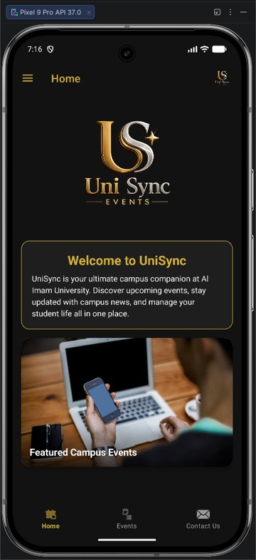
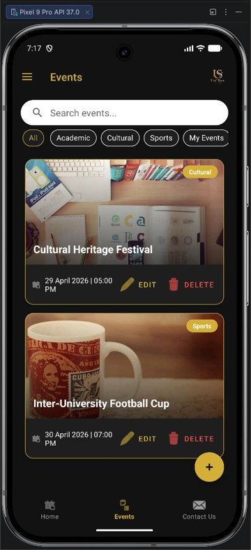
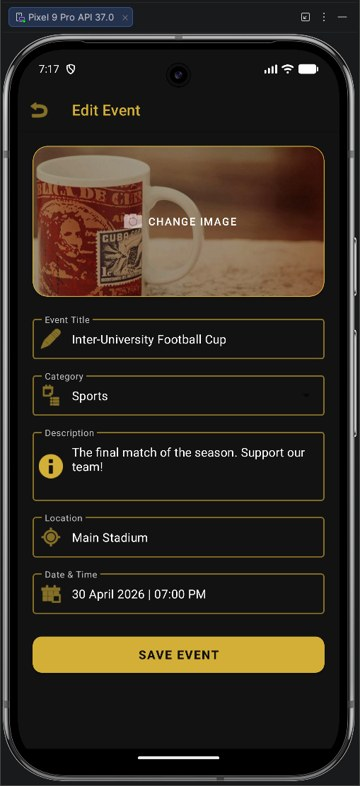
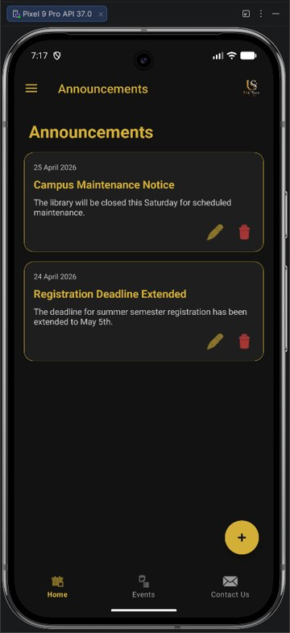

# UniSync Events

An Android app that helps university students discover, organize and manage campus events and announcements.

  
  
  
  

## Features
- Home page with a featured-events slideshow and a side navigation menu
- Event list with search and category filters (Academic, Cultural, Sports, My Events)
- Add, edit and delete events with images, categories, location, date and time
- Campus announcements: add, edit and delete
- Confirmation dialogs before deleting and feedback messages after saving
- Contact page with the developers' communication options

## Tech
Java · Android Studio · Room (SQLite) · View Binding · Material Components · Glide

## Data
Events and announcements are stored locally in a Room (SQLite) database with two tables, `campus_events` and `announcements`, accessed through a DAO. All database work runs on a background thread.

## Run it
Open the project in Android Studio, let Gradle sync, then run the `app` configuration on an emulator or Android device (Android 7.0 / API 24 or later).
